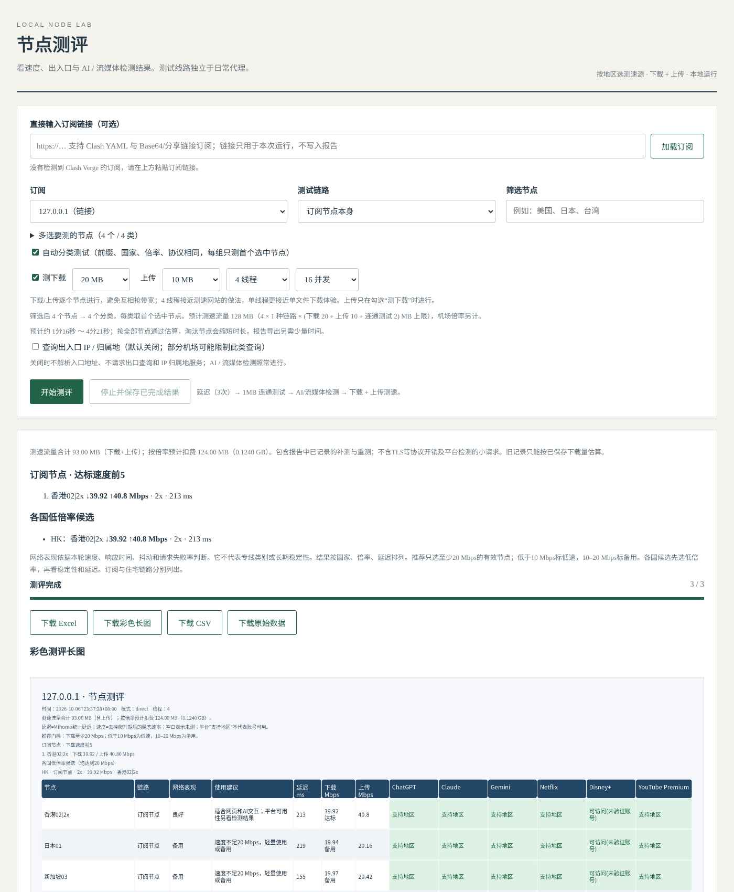

# 节点测评 · Clash Node Lab

在 Windows 本机批量测评机场订阅节点：**延迟、下载、上传、AI / 流媒体地区检测**，结果导出为 Excel、彩色长图、CSV 和 JSON。

测试时启动一个独立的 Mihomo 内核，使用单独的端口和规则，**不会切换、也不会修改你正在用的 Clash 节点和配置**。



## 快速开始

1. 下载本仓库（右上角 **Code → Download ZIP**），解压到任意文件夹。
2. 双击 **`启动测评.cmd`**。浏览器会打开 `http://127.0.0.1:8775`。
3. 选择 Clash Verge 里的订阅，**或者直接粘贴订阅链接**，点「开始测评」。

第一次启动时脚本会自动准备运行环境，大约需要 1 分钟：

| 需要的东西 | 没有时会怎样 |
|---|---|
| Windows 10 1803+（自带 `curl.exe`） | 提示升级系统 |
| Python 3.9+ | 有 winget 时自动安装 Python 3.12（仅当前用户）；否则提示去 python.org 下载 |
| PyYAML / Pillow / openpyxl | 自动装进 `app\.venv`，官方源失败时改用清华镜像 |
| Mihomo 内核 | 优先用已安装的 Clash Verge Rev 自带内核；没有就从 GitHub 下载到 `app\bin` |

没有安装 Clash Verge 也能用，只要在页面上粘贴订阅链接即可。想要桌面快捷方式，右键 `启动测评.cmd` → 发送到 → 桌面。

## 测什么，怎么测

测评分 4 个阶段：

1. **延迟**：调用 Mihomo 内核自带的延迟测试（开启 `unified-delay`），每个节点测 3 次，取中位数。这个值不含握手时间，约等于经节点访问 Google 的一个往返，和 Clash Verge 打开「统一延迟」后显示的数值可以对照。抖动 = 3 次中最大值减最小值；失败率是 3 次中失败的比例，不是 ICMP 丢包。
2. **1MB 连通测试**：只判断节点能不能真正下载数据，不当作速度。
3. **AI / 流媒体检测**：ChatGPT、Claude、Gemini、Netflix、Disney+、YouTube Premium。判断依据参考 [lmc999/RegionRestrictionCheck](https://github.com/lmc999/RegionRestrictionCheck)。这一步在测速之前跑完，不会和测速抢带宽。
4. **下载 + 上传测速**：节点一个一个测，避免互相抢带宽。

### 测速方法

- **按节点所在地区选测速源**：每个节点都从 CacheFly（全球 CDN）开始；如果失败，再试同地区的服务器（东亚用 Vultr 东京 / Hetzner 新加坡，东南亚用 Hetzner / Vultr 新加坡，美洲用 Vultr 洛杉矶 / Hetzner 美东，欧洲用 Hetzner 德国 / OVH），最后试 Cloudflare。某个节点换了测速源，不会影响下一个节点用哪个源。
- **稳态速率**：每次测速开头最多去掉 2 秒的 TCP 爬升期再计算速度，和测速网站的做法一致。从第一个字节开始算的平均速度另外列出。
- **4 线程（默认）或单线程**：4 线程反映节点能提供多少带宽；单线程更接近下载单个文件时的速度。
- **时间限制**：连接或等第一个字节最多 10 秒。下载时限按 2 MB/s 计算（例如 50 MB 最多 25 秒），上传按 1 MB/s 计算。到时间还没传完，就用已经传完的数据计算速度，并标注「限时采样」。
- **上传**：把随机数据 POST 到 Cloudflare；失败时改用 Speedtest 就近的服务器。等服务器回应后才停止计时，所以还停在本机缓冲区里的数据不会被算成已上传。

### 流量

预计流量 = 节点数 × 链路数 × (下载量 + 上传量 + 2 MB)。机场倍率另外计算，页面和报告里都会显示按倍率估算的扣费流量。上传通常也会计入机场流量。

## 结果怎么看

- 结果保存在 `测评结果\<时间>\`，包括 Excel（推荐节点 / 测评结果 / 检测详情）、彩色长图、CSV 和原始 JSON。
- 平台检测显示「支持地区」，只说明出口地区没有被拦截，**不代表账号能登录，也不代表视频能播放**。风控、地区限制、超时会分开标记，Excel 的「检测详情」表里有每一项的依据。
- 不同地区的节点用的测速服务器不同，跨地区比较速度只能作参考；同一地区内的节点可以直接比较。
- 出入口 IP / ASN 分析默认关闭。它不能完整追踪路由，也不能证明线路是 IEPL / IPLC 专线。
- 「经过住宅 IP」链路会读取 Clash Verge 配置里名称含「住宅」的 SOCKS5 节点，把它接在每个订阅节点后面测试。没有这类节点时不用管这个选项。

## 隐私

- 订阅链接只在本次运行时使用。它会被缓存到 `app\runtime\subscriptions`（已加入 .gitignore），不会写进报告。
- 报告导出前会删除密码、UUID、token 等字段，并隐藏除测速、检测地址以外的所有 URL。
- 所有请求都在本机发出，不会上传到任何第三方。

## 文件结构

```
启动测评.cmd        双击入口
start.ps1          环境检查与启动
app/node_lab.py     本地服务、独立内核、测评流程
app/speedtest.py    下载 / 上传测速
app/unlock_checks.py  AI / 流媒体检测
app/report_export.py  Excel / 长图 / CSV 导出
app/node_groups.py  按前缀、国家、倍率、协议给节点分类
```

可选环境变量：`MIHOMO_PATH`（指定内核路径）、`CLASH_VERGE_DIR`（指定 Clash Verge 配置目录）。

## 许可

MIT
